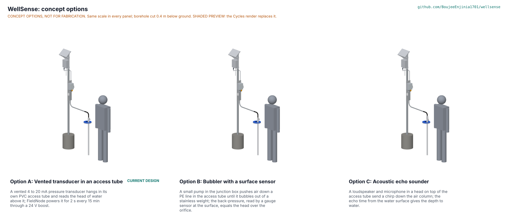

# WellSense concept options

Option A, the current design (a vented transducer in an access tube), scores 173 of 215 and option C, an acoustic echo sounder on the same tube, scores 164, 5.2 % behind; because they are within 10 %, both go to Amish without a pick (proposed, awaiting Amish; WLS-DDR-005). Option B, a bubbler, scores 147 and is not put forward. The repo stays on option A, as built, unless Amish decides otherwise. Method: STANDARDS section 21.

Figure 1. The three options at one scale, each from `components(option)` in `cad/src/model.py` at detail level D3, with a 1.75 m person. Until the coordinator renders the Blender Cycles picture with `.kit/options.py`, `media/options.png` is a shaded preview from `cad/src/options_preview.py`, labelled as such. CONCEPT OPTIONS, NOT FOR FABRICATION.

## The options

All three share what the TRL 3 work made constructable: the split HDPE seal plate with its spigot rings, gasket, wraps, rim band and collar (now with a clevis pin, WLS-DEC-001 D-S1), the 1 in PVC access tube drilled at its foot, the conduit with its flexible tail, the post, the junction box on its plate and the FieldNode core. They differ in how the water level becomes a number.

### Option A: vented transducer in an access tube (current design)

A vented 4 to 20 mA pressure transducer, 22 mm or less, hangs from a cable support grip on the eye bolt in the tube cap and reads the head of water above it; the vent capillary in its cable cancels air pressure. FieldNode switches its 12 V rail for 2 s every 15 min; a boost on the interface board raises it to 24 V to drive the loop through 63 m of cable, and a 150 Ω shunt and 16-bit ADC read the current. A tape reading fixes the offset and the probe's factory certificate the span (WLS-DEC-001 D-S3). First-order numbers (WLS-CAL-001): 0.52 mm resolution, 16.0 mm RSS (37.1 mm worst case) after calibration, 38.2 mWh a day, USD 264.40 at 30 m. Key risks: accuracy and drift of a low-cost probe (STM S7, S10), box temperature in sun (S21), drinking-water certificates for the probe and cable (PR-009), and whether the tube can pass an installed pump (PR-010). From a co-design partner it needs real well sizes, access to wells with pumps and a side-by-side tape record.

### Option B: bubbler with a surface sensor

A 12 V miniature diaphragm pump in the junction box pushes dried air down a 1/4 in PE line in the same access tube until it bubbles out of a stainless weight at the foot; when the pump stops, the line pressure, read by a 0 to 150 kPa gauge sensor on a board in the box, equals the head of water over the orifice plus the weight of the air column. A manifold block carries a vent valve and the line. Nothing electrical goes down the well; the wetted parts are PE and 316 stainless only. First-order numbers (WLS-STM-001 B1 to B7): 71 mm air column offset at 30 m, corrected in firmware; about 17 mm RSS after calibration; 263 mWh a day at 15 min, 11 % of FieldNode's allowance (PR-008 asks 5 %); estimated USD 233.40. Key risks: a small pump reaching 118 kPa (B4), pump and valve wear, a 1 min pumping test costing 15 times the 15 min energy, line leaks. From a partner it needs maintenance capacity for a pump.

### Option C: acoustic echo sounder

A sounder head replaces the tube cap: a 1-1/2 in PVC chamber over the 1 in socket holds an IP67 loudspeaker facing down the tube and a MEMS microphone board, with the eye bolt and padlock passing through the socket and the tube. A ranging board in the junction box sends a 500 Hz to 1 kHz chirp, records the echo from the water surface and converts the time of flight to depth to water; the tube joints, at known 3 m spacing, give echoes that calibrate the speed of sound, as oil-well echo sounders count tubing collars. Nothing goes below the water except the PVC tube already in option A. First-order numbers (WLS-STM-001 C1 to C5): 3.6 mm resolution at 48 kHz; ±20 mm at 30 m needs the column's mean temperature to 0.36 K or joint echoes; about 43 dB of wall loss at 500 Hz to water 50 m down; 10.6 mWh a day; estimated USD 204.80. Key risks: whether solvent-weld PVC joints reflect enough (C2), signal-to-noise at depth (C3), condensation on the head's electronics (C5), and new signal-processing firmware. From a partner it needs wells of known depth to water to prove the ranging.

## First-order numbers

Table 1. Options compared. Costs of B and C are estimates built from option A's priced BOM by swapping the sensing chain (no quotes); masses and part counts are from `cad/fidelity.json` and include the 0.6 m concrete post footing (about 90 kg) shared by all three.

| Quantity | Option A | Option B | Option C |
| --- | --- | --- | --- |
| Estimated parts cost at 30 m (USD) | 264.40 (priced BOM) | 233.40 (estimate) | 204.80 (estimate) |
| Mass, whole installation (kg) | 107.5 | 107.2 | 106.8 |
| Output | Level every 15 min, 1 min in tests | Level every 15 min; 1 min tests cost 15 times the energy | Level every 15 min, 1 min in tests |
| Resolution and accuracy after calibration | 0.52 mm; 16.0 mm RSS, 37.1 mm worst case | About 1 mm; about 17 mm RSS | 3.6 mm; unknown until joint echoes are proven |
| Sensor energy at 15 min | 38.2 mWh/day (1.6 % of allowance) | 263 mWh/day (11 %) | 10.6 mWh/day (0.4 %) |
| Parts in the model (fasteners) | 132 (73) | 129 (71) | 129 (71) |
| Wetted parts | 316 probe, PU or PE cable, PVC tube | PE line, 316 weight, PVC tube | PVC tube only |
| STEM check | Within known science after fixes D-S1 to D-S4; S7, S10 and S21 open (TRL 4) | No failing row; B4 and B7 plausible | No failing row; C2, C3 and C5 plausible |

## Scoring

Table 2. Weighted scoring against WLS-URS-001 (weights: High UR 3, Medium 2, Low 1; scores 1 to 5). Cost against the value-engineering target is scored under UR-009 and maintenance under UR-014, so neither is counted twice.

| Criterion | Source | Weight | A | B | C | Reason |
| --- | --- | --- | --- | --- | --- | --- |
| Trustworthy level record | UR-001 | 3 | 4 | 3 | 2 | A is the USGS-standard method with a calculated budget inside 20 mm RSS; B adds an air column correction on a sensor at 1.5 times the range; C depends on an unproven speed-of-sound calibration |
| Works in our wells | UR-002 | 3 | 5 | 4 | 3 | A works to 60 m; B's purge time and air column grow with depth; C loses 43 dB or more when water is 50 m down |
| Pumping and recovery | UR-003 | 2 | 5 | 2 | 4 | A and C read every minute cheaply; B runs its pump for every reading |
| Nothing lost when the network drops | UR-004 | 2 | 5 | 5 | 5 | Same FieldNode storage |
| No extra power | UR-005 | 3 | 5 | 2 | 5 | 1.6 %, 11 % and 0.4 % of the allowance |
| Drinking water stays safe | UR-006 | 3 | 3 | 4 | 5 | A needs certificates for a probe and a vented cable; B only for a PE line and a stainless weight; C puts nothing new in the water |
| Leave the pump alone | UR-007 | 3 | 3 | 3 | 3 | All three need the same access tube beside the pump |
| Quick to install | UR-008 | 2 | 4 | 3 | 4 | B adds a leak test of the pneumatic line |
| Affordable | UR-009 | 3 | 2 | 3 | 4 | USD 264.40, about 233 and about 205 against the USD 200 target |
| Readable on a phone | UR-010 | 2 | 3 | 3 | 3 | Same dashboard, not started |
| Our data | UR-011 | 2 | 5 | 5 | 5 | Levels only in every option |
| Survives the wellhead | UR-012 | 3 | 4 | 3 | 3 | A's probe is sealed and the vent is dried; B has a pump and valve to wear; C has electronics in saturated air |
| Hard to tamper with | UR-013 | 2 | 4 | 4 | 4 | Same locks and conduit |
| Light upkeep | UR-014 | 2 | 4 | 2 | 3 | A: desiccant each quarter; B: pump diaphragm, inlet desiccant, line purge; C: head condensation and insects |
| Safe to work on | UR-015 | 3 | 5 | 5 | 5 | 24 V or less in every option |
| Buildable with local skills and tools | STANDARDS section 21 | 2 | 4 | 3 | 3 | A uses bought modules; B adds pneumatic fittings; C needs new ranging firmware |
| Safety | STANDARDS section 21 | 3 | 4 | 4 | 4 | Same wellhead hazards; B's line holds about 120 kPa of air, a negligible stored energy |
| **Weighted total (of 215)** | | | **173** | **147** | **164** | |

## Recommendation

Proposed, awaiting Amish (WLS-DDR-005, WLS-DEC-001 open decision O-1). Options A and C are within 10 % (173 against 164), so both go to Amish without a pick, as STANDARDS section 21 asks. A is the proven method and is fully designed, priced and drawn; C is cheaper, puts nothing new in the water and uses a quarter of A's energy, but its accuracy rests on an echo calibration nobody has shown in a PVC tube. Option B is not put forward: its pump energy misses PR-008 and it adds wear parts.

The runner-up's best idea to graft onto A, whichever Amish chooses: C's observation that the tube's joints sit at known depths. Recording the depth of every joint on the build sheet costs nothing and would let a future acoustic check head, or a tape, confirm the probe depth without pulling it. B's desiccant-dried inlet idea is already in A's vent breather.

If Amish chooses C, the sounder head, ranging board and firmware go through their own STEM rows (C2, C3, C5) and a TRL 4 echo test before any redesign of the drawing, BOM or build plan; until then the repo stays on option A.
